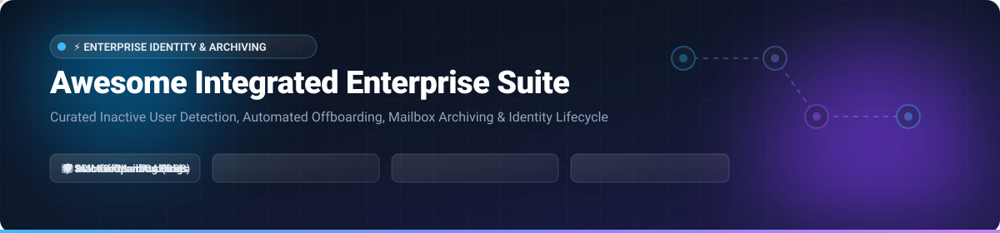

<div align="center">

<a href="https://github.com/ishandutta2007/Awesome-Awesome-Awesome"></a>
<a href="https://discord.gg/jc4xtF58Ve"></a>
<a href="https://github.com/ishandutta2007/Awesome-Integrated-Enterprise-Software-Suite/stargazers"></a>
<a href="https://github.com/ishandutta2007/Awesome-Integrated-Enterprise-Software-Suite/network/members"></a>
<a href="https://github.com/ishandutta2007/Awesome-Integrated-Enterprise-Software-Suite/issues"></a>
<a href="https://github.com/ishandutta2007/Awesome-Integrated-Enterprise-Software-Suite/blob/main/LICENSE"></a>
<a href="https://github.com/ishandutta2007"></a>

<br /><br />

<a href="https://github.com/ishandutta2007/Awesome-Integrated-Enterprise-Software-Suite">
  
</a>

# 🏢 Awesome Integrated Enterprise Software Suite

### 🚀 Top Inactive User Data Archiving, Automated Offboarding & Identity Lifecycle Ecosystem

[](https://github.com/ishandutta2007/Awesome-Integrated-Enterprise-Software-Suite/pulls)
[](https://github.com/ishandutta2007/Awesome-Integrated-Enterprise-Software-Suite/graphs/commit-activity)
[](https://github.com/ishandutta2007/Awesome-Integrated-Enterprise-Software-Suite)

*A definitive, curated directory of **Enterprise SaaS Platforms** and **Open-Source Software (OSS)** engineering solutions for **Inactive User Detection**, **Automated Employee Offboarding Workflows**, **SaaS License Reclamation**, **Compliance Data Retention**, **Exchange/Gmail Mailbox Archiving**, and **Identity Governance & Administration (IGA)**.*

📅 **Last updated: November 2026**

</div>

---

## 📖 Overview

In modern cloud-first enterprises, employee departures and inactive accounts represent critical security vulnerabilities, compliance liabilities, and runaway SaaS software spend. Unmanaged leaver states expose companies to data leaks, orphan account takeover, shadow IT proliferation, and unnecessary license renewals.

This repository tracks the leading **SaaS platforms** and **open-source identity architectures** purpose-built to automate the **Joiner-Mover-Leaver (JML)** lifecycle:
- 🔍 **Inactive User & Dormant Account Detection**: Continuous monitoring of last-login timestamps, SSO audit events, and HRIS signals.
- ⚡ **Structured Employee Offboarding Workflows**: Instant revocation of IdP sessions, multi-SaaS access deprovisioning, OAuth token cancellation, and hardware reclamation.
- 📦 **Data Retention & Mailbox Archiving**: Automated placement of departing users on legal holds, converting accounts into free inactive mailboxes (Exchange Online / Google Workspace AU), and backing up SaaS drive data.
- 📂 **Ownership & Asset Delegation**: Automatic reassignment of calendar meetings, Google Drive files, SharePoint repositories, and Salesforce records to managers.
- 🛡️ **Regulatory Compliance & Auditability**: Enforcing SOC 2, ISO 27001, HIPAA, GDPR, and DORA standards with tamper-proof deprovisioning audit trails.

---

## 📑 Table of Contents

- [📊 Sector Overview & Market Dynamics](#-sector-overview--market-dynamics)
- [☁️ SaaS & Hosted Enterprise Platforms](#️-saas--hosted-enterprise-platforms)
- [🔓 Open-Source GitHub Projects](#-open-source-github-projects)
- [🏗️ Implementation Architecture & Patterns](#️-implementation-architecture--patterns)
- [🤝 How to Contribute](#-how-to-contribute)
- [💖 Support & Sponsorship](#-support--sponsorship)
- [⭐ Star History](#-star-history)
- [⚖️ Disclaimer](#️-disclaimer)

---

## 📊 Sector Overview & Market Dynamics

The enterprise sector encompassing **Identity Governance and Administration (IGA)** and **SaaS Management Platforms (SMP)** represents an estimated **$14B – $27B total addressable market in 2026**, expanding rapidly at an estimated **10%–15% CAGR** under tightening zero-trust frameworks and compliance mandates (GDPR, DORA, NIS2, HIPAA). 

The market dynamics exhibit **moderate fragmentation alongside ongoing platform consolidation**: while horizontal hyperscalers and legacy identity powerhouses (Microsoft, Alphabet, Okta, SailPoint) secure core identity lifecycle contracts, agile pure-play vendors (BetterCloud, Torii, Lumos, Druva) continue to capture significant enterprise share through turnkey multi-SaaS connectors, automated shadow IT discovery, deep JML workflow orchestration, and granular mailbox/data archiving.

---

## ☁️ SaaS & Hosted Enterprise Platforms

The table below lists leading commercial SaaS suites for inactive account detection, automated deprovisioning, license reclamation, and compliance data archiving, sorted in descending order by **enterprise company size (market valuation / market capitalization)**.

| Product | Company Valuation / Market Cap | Pricing (Starting Tier) | Free Tier / Free Trial Limits | Key Offboarding & Archiving Capabilities |
| :--- | :--- | :--- | :--- | :--- |
| **[Microsoft 365 Inactive Mailbox](https://www.microsoft.com/en-us/microsoft-365)** | ~$3.84T (Market Cap) | $8.00/user/month (Exchange Online Plan 2) | No direct standalone trial for Plan 2; standard 30-day trial available via Microsoft 365 E3/E5 suites (up to 25 licenses) | Places departing user mailboxes on Litigation/Retention Hold; upon deleting account, mailbox converts to an Inactive Mailbox retaining all data without ongoing license cost. |
| **[Google Workspace Inactive User Policy](https://workspace.google.com/)** | ~$3.50T (Market Cap) | $2.00/user/month (Business Starter Archived User - AU License) | 14-day free trial on primary Google Workspace plans (up to 10 users); no standalone free trial for AU licenses | Retains departing user data, files in Google Drive, and Gmail under Google Vault retention policies at reduced licensing costs without active user access. |
| **[Okta Lifecycle Management](https://www.okta.com/)** | ~$31.0B (Market Cap) | $14.00/user/month (Core Essentials tier, $1,500 annual contract minimum) | 30-day free trial (Workforce Identity Cloud environment supporting up to 10 test users and workflow executions) | Automated Joiner-Mover-Leaver (JML) provisioning and deprovisioning, inactivity detection, and Okta Workflows for triggering custom revocation scripts across SaaS apps. |
| **[Rippling Offboarding](https://www.rippling.com/)** | ~$16.0B (Valuation) | $8.00/user/month (+ $35.00/month base platform fee; IT Cloud add-on starts at additional $5.00/user/month) | No standard self-service free trial for core HR; 14-day evaluation trial available for standalone IT/Device management modules | Automatically detects termination/leave in HRIS to instantly revoke SSO/SaaS logins, retrieve corporate hardware, and initiate file transfer/delegation. |
| **[SailPoint Lifecycle Management](https://www.sailpoint.com/)** | ~$12.8B (Valuation) | ~$5.00 – $7.50/identity/month (~$60–$90/identity/year; software subscription entry starts at ~$75,000/year minimum) | No public self-service free trial; scoped 30-day to 90-day enterprise Proof of Concept (PoC) available via direct sales | Enterprise IGA platform delivering end-to-end joiner-mover-leaver lifecycle controls, automated deprovisioning, role revocation, and audit certification reporting. |
| **[Druva Inactive User Retention](https://www.druva.com/)** | ~$2.0B (Valuation) | ~$4.00 – $8.00/user/month (Druva inSync SaaS/Endpoint Protection) | 30-day free trial (Full-featured access for cloud apps and endpoint backup, no credit card required) | Comprehensive cloud backup for Google Workspace, M365, and laptops; preserves inactive user snapshots and enables legal holds without keeping native SaaS licenses active. |
| **[BambooHR Offboarding](https://www.bamboohr.com/)** | ~$1.9B (Valuation) | $10.00/employee/month (Core Plan for >25 employees; $250/month flat fee for ≤25 employees) | 7-day free trial (Full platform sandbox access, no credit card required) | Structured offboarding checklists, task assignments, and webhook/API triggers for IT deprovisioning and asset handover when an employee departs. |
| **[BetterCloud](https://www.bettercloud.com/)** | ~$400M (Valuation) | Custom quote based on seats & connectors; starting tiers entry ~$3.00 – $6.00/user/month (~$5,000/year minimum) | Spend Optimization Free tier available ($0/month for basic spend and contract tracking); 14-day free trial for File Governance/SaaS management modules | No-code SaaS operations automation that listens for inactive accounts, deprovisions multi-SaaS access, transfers Google Drive/OneDrive files, and forwards email. |
| **[Torii](https://www.toriihq.com/)** | ~$350M (Valuation) | Entry tiers start at ~$2.00 – $2.50/employee/month (billed annually, custom enterprise plans based on total employee count) | Free trial / Proof-of-concept (PoC) available upon request (14 to 30 days guided evaluation) | Discovers shadow IT and inactive SaaS licenses; triggers automated multi-app offboarding workflows to revoke access and reallocate or cancel unused seat licenses. |
| **[Lumos](https://www.lumos.com/)** | ~$250M (Valuation) | Custom quote based on identity volume; mid-market deployments typically start around ~$3.00/user/month ($10,000 annual entry) | No public self-serve free trial; 30-day guided Proof of Concept (PoC) pilot available upon enterprise request | Unified AppStore and Identity Governance platform automating access revocation, software license reclamation, and inactive user privilege cleanups. |

---

## 🔓 Open-Source GitHub Projects

The following open-source identity governance platforms, directories, access brokers, and automation frameworks provide modular building blocks for self-hosted inactive user detection, access deprovisioning, and data archiving. Entries are sorted in descending order by **GitHub star count**.

| Project | GitHub Stars | Focus / Role in Offboarding & Archiving |
| :--- | :--- | :--- |
| **[Ansible](https://github.com/ansible/ansible)** | [](https://github.com/ansible/ansible/stargazers) | Playbooks and automation roles that disable target accounts, revoke SSH keys, transfer data ownership, and archive user home directories. |
| **[Keycloak](https://github.com/keycloak/keycloak)** | [](https://github.com/keycloak/keycloak/stargazers) | Standard enterprise open-source IdP; provides REST admin APIs and event listeners to trigger account deactivation and downstream offboarding webhooks. |
| **[Authelia](https://github.com/authelia/authelia)** | [](https://github.com/authelia/authelia/stargazers) | Lightweight authentication and authorization server; centralizes session revocation and access cutoff across reverse proxy-protected internal apps. |
| **[Authentik](https://github.com/goauthentik/authentik)** | [](https://github.com/goauthentik/authentik/stargazers) | Modern IdP featuring rich configurable flows, SCIM provider/consumer support, and stage bindings to coordinate automated user suspension and access revocation. |
| **[Ory Hydra](https://github.com/ory/hydra)** | [](https://github.com/ory/hydra/stargazers) | Hardened OAuth 2.0 and OpenID Connect engine with administrative endpoints to revoke access/refresh tokens and terminate active client sessions during offboarding. |
| **[Zitadel](https://github.com/zitadel/zitadel)** | [](https://github.com/zitadel/zitadel/stargazers) | Cloud-native identity infrastructure with multi-tenancy, granular audit logs, and APIs designed to programmatically lock accounts and automate leaver flows. |
| **[Casdoor](https://github.com/casdoor/casdoor)** | [](https://github.com/casdoor/casdoor/stargazers) | Modern UI-first identity and access management (IAM) platform supporting SCIM, LDAP synchronization, and Webhooks for event-driven offboarding hooks. |
| **[Ory Kratos](https://github.com/ory/kratos)** | [](https://github.com/ory/kratos/stargazers) | Headless identity and user management system supporting explicit account states (`active`, `inactive`) and identity deletion APIs for lifecycle handling. |
| **[mailcow: dockerized](https://github.com/mailcow/mailcow-dockerized)** | [](https://github.com/mailcow/mailcow-dockerized/stargazers) | Self-hosted mailserver suite with API-driven mailbox archiving, quarantine controls, alias reassignment, and account deactivation for departing staff. |
| **[Dex IdP](https://github.com/dexidp/dex)** | [](https://github.com/dexidp/dex/stargazers) | Pluggable OpenID Connect identity provider that acts as a portal to upstream directories (LDAP, SAML, GitHub), enabling global access cutoff at the root directory level. |
| **[Kanidm](https://github.com/kanidm/kanidm)** | [](https://github.com/kanidm/kanidm/stargazers) | Rust-based identity management system with strong authentication, strict POSIX/OAuth2/LDAP controls, and deterministic account suspension rules. |
| **[FreeIPA](https://github.com/freeipa/freeipa)** | [](https://github.com/freeipa/freeipa/stargazers) | Integrated Linux/Unix identity and domain management with host-based access control (HBAC), sudo policies, and user locking for infrastructure offboarding. |
| **[Janssen Project](https://github.com/JanssenProject/jans)** | [](https://github.com/JanssenProject/jans/stargazers) | High-performance open-source IAM and identity governance components (from Gluu) for identity lifecycle and high-throughput SCIM operations. |
| **[midPoint](https://github.com/Evolveum/midpoint)** | [](https://github.com/Evolveum/midpoint/stargazers) | Flagship open-source Identity Governance and Administration (IGA) platform featuring complete Joiner-Mover-Leaver (JML) lifecycle workflows, role mining, and automated connector deprovisioning. |
| **[Apache Syncope](https://github.com/apache/syncope)** | [](https://github.com/apache/syncope/stargazers) | Enterprise open-source digital identity management system handling synchronization, identity lifecycle workflows, and automated deprovisioning connectors. |

---

## 🏗️ Implementation Architecture & Patterns

```
 [HRIS / Trigger Event] ➡️ (Employee Departure / Inactive Threshold Met)
           │
           ▼
 [Central Identity Engine] ──(midPoint / Keycloak / Authentik / Okta)
           │
     ┌─────┴──────────────────────────────┬──────────────────────────────┐
     ▼                                    ▼                              ▼
[Identity Suspension]             [SCIM Deprovisioning]          [Compliance Archiving]
 • Lock IdP User Account          • Revoke SaaS App Accounts     • Convert M365 Inactive Mailbox
 • Invalidate OAuth Tokens        • Reclaim Software Licenses    • Google Workspace AU License
 • Terminate SSO Sessions         • Reassign File/Drive Assets   • Snapshot Endpoints (Druva/S3)
```

- **Full Open IGA Lifecycle**: **midPoint** functions as the direct open-source counterpart to enterprise suites like SailPoint, providing native Joiner-Mover-Leaver (JML) state management, automated entitlement revocation, and inactive user reconciliation.
- **IdP-Driven Deprovisioning**: Deploy **Keycloak**, **Authentik**, **Zitadel**, or **Casdoor** as the central identity broker. Suspending an account at the IdP instantly severs SSO access across all SAML/OIDC federated enterprise apps.
- **SCIM Protocol Automation**: Using open SCIM 2.0 connectors ensures that deactivating an account in the primary identity directory propagates real-time suspension and license revocation to downstream cloud services.
- **Data Archiving & Mailbox Preservation**: Infrastructure orchestration via **Ansible** alongside self-hosted services like **mailcow** allows organizations to snapshot user mailboxes, archive home directories to immutable S3 storage, and reassign critical mailbox aliases before purging active identities.

---

## 🤝 How to Contribute

Contributions are welcome and appreciated! To maintain high resource quality:

1. 🍴 **Fork** this repository.
2. 📝 **Add or Update** entries in `README.md` following the table formatting:
   - For SaaS products: include starting tier pricing, free tier/trial limits, company size/valuation, and verified offboarding features.
   - For Open-Source projects: include the star count badge linking to stargazers and concise technical architectural focus.
3. 🔎 **Verify Links**: Ensure all documentation and repository URLs are valid and active.
4. 🚀 **Submit a Pull Request** with a brief summary of the added tools.

---

## 💖 Support & Sponsorship

If you find this enterprise software curation helpful for your IT, security, or identity operations, please consider showing your support:

- ⭐ **Star this repository** to help others discover it across GitHub.
- 🍴 **Fork and share** the project with your IT operations and security engineering teams.
- ☕ **Sponsor or buy a coffee**: Support ongoing curation, maintenance, and research through the [GitHub Sponsors Dashboard](https://github.com/sponsors/ishandutta2007).

Your backing directly fuels continuous research and documentation of enterprise identity and software management ecosystems! Thank you! 🙏

---

## ⭐ Star History

[](https://www.star-history.com/#ishandutta2007/Awesome-Integrated-Enterprise-Software-Suite&type=date&legend=top-left)

---

## ⚖️ Disclaimer

- This is a **community-curated** reference list — not exhaustive and not an official commercial endorsement.
- Offboarding, employee deprovisioning, and data retention involve personal data, access controls, and strict legal retention obligations (GDPR, HIPAA, SOC 2, CCPA). Ensure all policies comply with applicable local employment, privacy, and compliance regulations. This list does not constitute legal, HR, or security compliance advice.

---

<div align="center">
  <b>Built for Identity Architects, IT Ops, Security Engineers, and Enterprise Open-Source Advocates. 🛡️</b>
</div>
